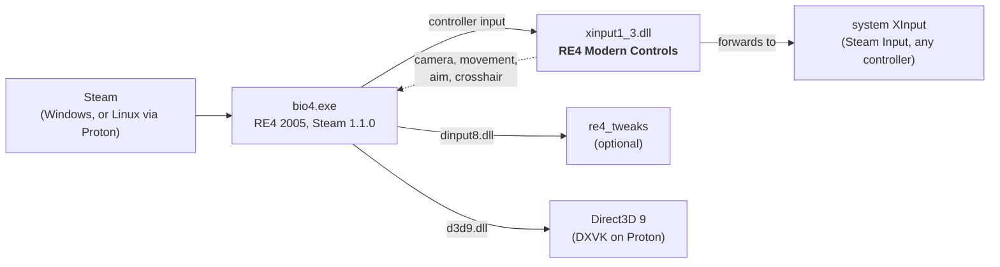

<div align="center">

# RE4 UHD Modern Controls

**Play the original Resident Evil 4 (2005) with modern, remake-style controls.**
No more tank controls: move where you push the stick, look around freely, walk while you aim.

[](https://github.com/TuxLux40/re4uhd-modern-controls/actions/workflows/release.yml)
[](https://github.com/TuxLux40/re4uhd-modern-controls/releases)
[](LICENSE)


</div>

> [!NOTE]
> **Early version.** Everything below works, but expect rough edges. See [Planned](#planned) and
> [Known issues](#known-issues). Work on leg animations and fading characters happens on the
> [beta branch](https://github.com/TuxLux40/re4uhd-modern-controls/tree/beta).

## Features

| | |
|---|---|
| 🕹️ **Camera-relative movement** | Push the left stick toward any direction on screen and Leon goes there. He runs by default; hold the run button to walk. |
| 🎥 **Free camera over the shoulder** | The right stick turns the camera freely around Leon. It sits a little to the right, over his shoulder, like RE5 (`Shoulder=0` centres it). Leave the stick alone while moving and it eases back behind him. It stops at walls. |
| 🎯 **Aim where you look** | Raise the gun and the view keeps looking where it looked while the camera moves in close over Leon's right shoulder, like RE5. Leon turns to aim there. Aim with the right stick. `KeepViewOnAim=0` swings the view to where Leon looks instead. |
| 🔫 **Weapon quick select on the d-pad** | Like the remake: up handguns, right shotguns, down rifles, machine guns and launchers, left grenades. Press a direction again for the next weapon of that kind you carry. The lists are in the ini; `DpadSelect=0` gives the d-pad back to the original tank controls. |
| 🚶 **Walk while aiming** | Move with the left stick while aiming. RE4 has no strafe animations, so the mod puts a walk cycle on Leon's legs while his arms keep the aim (`Legs=0` turns it off and he glides). |
| ➕ **Remake-style crosshair** | A reticle in the middle of the screen, and your shots and the laser go there. The camera follows your aim, never the gun, so recoil doesn't shake the view. The original aim sway is gone. Instead the ticks open up while you walk, turn or fire and close again when you hold still, and shots land anywhere inside them. The laser is just a beam now, without its red dot. `CenteredAim=0` brings back the original camera, sway and laser, with the reticle following the laser. |
| 🔴 **Target indicator** | The centre dot turns red and grows while it rests on something that takes damage (enemies, lamps, barrels). Outside of aiming a small dot marks the middle of the screen (`CenterDot=0` hides it). |
| 🛡️ **Ashley is safe from your shots** | With the camera free, it's easy to catch her in the crossfire. Your guns and knife no longer hurt her, the way her armour costume protects her; enemies and explosions still do. Can be switched off. |
| 👻 **Fade when the camera is close** | Leon and Ashley turn see-through when the camera gets close to them (Ashley right behind Leon, a wall at your back), in two steps so the model never pops out entirely. `Fade`, `FadeNear`, `FadeFar` and `FadeMin` in `[Camera]` tune it. Enemies are never affected. |

## Install

1. **Download** the latest zip from the
   [**Releases**](https://github.com/TuxLux40/re4uhd-modern-controls/releases) page and extract it anywhere.
2. **Run the installer**

   | Windows | Linux / Steam Deck (Desktop Mode) |
   |---|---|
   | Double-click `install.bat` | Right-click `install.sh` → **Run in Konsole**, or run `./install.sh` |

3. **Answer a few questions**, or press <kbd>Enter</kbd> for the recommended settings. Then start the game from Steam
   as usual.

The installer finds the game in your Steam libraries, installs the mod, saves your settings and, on Linux, tells
Proton to load it. There's nothing to paste into Steam. Run it again to change your settings; uninstall with
`install.bat -Uninstall` or `./install.sh --uninstall`.

<details>
<summary><b>Manual install</b></summary>

1. Steam → right-click **Resident Evil 4** → **Manage** → **Browse local files**.
2. Copy `files/xinput1_3.dll` from the zip into the `Bin32` folder (next to `bio4.exe`).
3. Linux / Steam Deck only: **Properties** → **Launch Options**:
   ```
   WINEDLLOVERRIDES="xinput1_3=n,b" %command%
   ```
   With re4_tweaks: `WINEDLLOVERRIDES="dinput8,xinput1_3=n,b" %command%`

To uninstall, delete `Bin32/xinput1_3.dll` and the `RE4ModernControls.ini` / `.log` next to it.
</details>

## Controls

| | Moving around | While aiming |
|---|---|---|
| **Left stick** | Move toward that direction on screen | Walk |
| **Right stick** | Turn the camera | Aim |
| **LT** | Aim: the camera moves in over Leon's shoulder | |
| **RT** | Fire from the hip: Leon raises the gun, shoots at the centre dot and lowers it again | Fire |
| **LB** | Ready the knife (RT swings) | |
| **A** | Action: doors, items, ladders, kicks | |
| **X** | Reload: the camera stays put, nothing happens with a full magazine | Reload |
| **B** | Hold to walk instead of run | |
| **Y / Back / Start** | Inventory / map / options (save, load) | |
| **RB** | Ashley: wait / follow | |
| **D-pad** | Weapon quick select (again: the next one of that kind) | Weapon quick select |

This is the RE5-style layout (`[Buttons] Layout=RE5`). Set `GameType` to the layout chosen in the game's own options so the mod presses the right buttons: 1, 2 or 3 for Type I, II or III in its Controller Setup (Type I is the default). Menus, the inventory and cutscene prompts keep the game's own
layout. The game's action prompts ("X Open", "X Save") would show X while A acts, so they are hidden
(`HideActionPrompt=0` brings them back), and quick-time events pass on their own since their prompts go with them
(`AutoQTE=0` turns that off). `Layout=Original` keeps the game's buttons everywhere (RT aim, X action and fire, A run and reload, LT knife,
Y map, Start inventory).

> [!TIP]
> **Prefer the classic tank controls now and then?** With `[Weapons] DpadSelect=0` the d-pad drives Leon with the
> original tank controls again, so you can switch to it whenever you want the precise, classic handling, for example
> to line up with a ladder or a tight doorway.

## Settings

The installer asks about the main choices: run behaviour, walking while aiming, the crosshair, protecting Ashley from
your shots, camera height and inverted camera. Run it again any time to change them. For fine-tuning (turn and camera speeds, exact camera height
and angle, how fast the camera follows Leon) there is `Bin32/RE4ModernControls.ini`, which explains every option; changes apply while the game runs.
An in-game settings page is [planned](#planned).

## Compatibility



The mod is a single DLL that the game loads in place of the system's controller library. It passes controller
input through, adjusts it, and hooks the game's own camera and movement code. It doesn't touch any game files, so
texture packs and other file-based mods are unaffected.

**Legend:** ✅ works and tested · 🟢 should work, not tested yet · ⚠️ works with a catch · ❌ not supported

### Game versions

| Version | Status | |
|---|:---:|---|
| Steam, current update (1.1.0) | ✅ | The version everyone gets from Steam today |
| Older Steam builds (1.0.x) | ❌ | Detected and left alone: the mod stays off, the game plays normally |
| 2007 Ubisoft PC port, console versions | ❌ | A different game executable |

> [!TIP]
> On any version it doesn't recognise, the mod checks the game's code before changing anything, logs the mismatch
> and stays inactive. It cannot break the game.

### Systems

| System | Status | |
|---|:---:|---|
| Linux, Proton 11.0 (CachyOS) | ✅ | Tested |
| Linux, other Proton / GE-Proton versions | 🟢 | Only uses standard XInput and Direct3D 9, nothing Proton-specific |
| Other Linux distributions, Flatpak or Snap Steam | 🟢 | Runs inside Proton, so the distro doesn't matter; the installer checks all Steam locations |
| Steam Deck (SteamOS) | 🟢 | Same as Linux; run the installer in Desktop Mode |
| Windows 10 / 11 | 🟢 | Installer and DLL load are tested automatically on Windows; not yet played on Windows |

### Controllers

| Input | Status | |
|---|:---:|---|
| Xbox controllers | ✅ | |
| PlayStation, Switch and other pads through Steam Input | ✅ | Steam Input presents them as an Xbox controller |
| Keyboard and mouse | ⚠️ | Unchanged: the mod only changes controller controls |

### Other mods

| Mod | Status | |
|---|:---:|---|
| [re4_tweaks](https://github.com/nipkownix/re4_tweaks) | 🟢 | Loads separately (`dinput8.dll`). Keep its camera and mouse-turning options at their defaults |
| RE4 HD Project, texture and model mods | 🟢 | They replace game files; this mod doesn't touch files |
| ReShade, other Direct3D 9 overlays | 🟢 | The crosshair is drawn just before each frame is shown |
| Other mods that use `xinput1_3.dll` (controller wrappers) | ❌ | Same file name, only one can be installed; the installer keeps a backup of the other one |

Tried it on a setup that isn't listed? Please [open an issue](https://github.com/TuxLux40/re4uhd-modern-controls/issues)
either way, so this table can grow.

## Planned

- [ ] In-game settings page for the basic choices: modern or tank controls, run by default, free or classic camera
- [ ] Settings window for the fine-tuning: a small program next to the game that edits `RE4ModernControls.ini` with
  switches and sliders instead of a text editor (speeds, distances, the camera's shoulder spot...); the mod already
  applies saved changes while the game runs
- [ ] Ada and the other Mercenaries characters: the legs while aiming and reloading on the move only know Leon's
  skeleton, so Ada (Separate Ways, Assignment Ada) and the Mercenaries characters need their own bone mapping
- [ ] Sort the case automatically, like the remakes (a button in the open case)
- [ ] Leon's gun pointing exactly at the reticle (the laser bends toward it for now)
- [x] Remake-style weapon quick select on the d-pad
- [x] Reload on the move: the legs play Leon's own walk under the reload, at his walking speed
- [ ] Calibrate the legs on the move: the step at the end of a reload still jumps a little (mostly the right leg),
  and the walk under the reload could match the hips and the step length better
- [ ] Fire from the hip on the move with the walk on the legs, the same way as the reload (Leon only slows down for
  now); and quick turn in the RE3
  (2020) style
- [ ] Support for other game builds by finding the game's code instead of relying on fixed addresses

## Known issues

- The shoulder distances (`ShoulderRight`, `ShoulderBack`, `ShoulderHeight`, `Shoulder`) are first guesses;
  they can be changed in the ini while the game runs.
- Leon's gun doesn't always point exactly at the reticle, so the laser leaves the gun at a slight angle. Shots
  still go to the reticle.
- Reloading on the move: Leon's legs walk, but where the reload ends and he walks or runs on, his legs still jump a
  little (mostly the right leg). Firing from the hip on the move: Leon slows down and glides, without the walk on his
  legs.
- Walking while aiming: his legs step with a simple walk cycle of the mod's own (`Legs=0` turns it off and he glides);
  RE4 has no strafe animations.
- Walking while aiming follows slopes and stops at walls; Ashley is kept on the ground behind you.

Found a bug? [Open an issue](https://github.com/TuxLux40/re4uhd-modern-controls/issues), and attach
`Bin32/RE4ModernControls.log` if you can.

## Credits

| | |
|---|---|
| **RE3Controls** for Resident Evil 5, by palecvzhope (MIT) | The idea, the design and the XInput proxy this mod started from |
| [**re4_tweaks**](https://github.com/nipkownix/re4_tweaks), by nipkow and contributors (zlib) | The reverse-engineered RE4 structures and code locations this mod builds on; the automatic QTEs are ported from its `DisableQTE` (`src/qte.cpp`, altered) |
| [**boshjerns' RE4 SDK**](https://github.com/boshjerns/re4-boshjerns-sdk), by boshjerns (MIT) | The legs while aiming are ported from its "legs v5" (`src/legs.cpp`, altered) and the test kit's command channel (`src/testkit.cpp`) follows its design |
| [**Ghidra**](https://github.com/NationalSecurityAgency/ghidra) (NSA) | Disassembly and decompilation of the game |
| [**REA: Reverse Engineer Anything**](https://github.com/morluto/rea), by morluto | Reverse-engineering tooling for AI agents, used to analyse the game |
| [**MinHook**](https://github.com/TsudaKageyu/minhook), by Tsuda Kageyu (BSD 2-clause) | Function hooking |

<sub>Resident Evil is a trademark of Capcom. This project contains no game code or assets. Developers: see
[docs/DEVELOPMENT.md](docs/DEVELOPMENT.md) for building and [docs/RE-NOTES.md](docs/RE-NOTES.md) for the
reverse-engineering notes.</sub>
