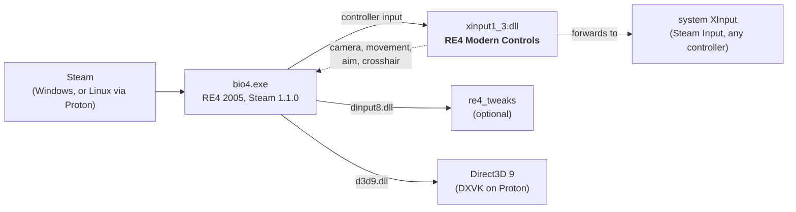

<div align="center">

# RE4 OG Modern Controls

**Play the original Resident Evil 4 (2005) with modern, remake-style controls.**
No more tank controls: move where you push the stick, look around freely, walk while you aim.

[](https://github.com/TuxLux40/re4og-modern-controls/actions/workflows/release.yml)
[](https://github.com/TuxLux40/re4og-modern-controls/releases)
[](LICENSE)


</div>

> [!NOTE]
> **Early version.** Everything below works, but expect rough edges. See [Planned](#planned) and
> [Known issues](#known-issues).

## Features

| | |
|---|---|
| 🕹️ **Camera-relative movement** | Push the left stick toward any direction on screen and Leon goes there. He runs by default; hold the run button to walk. |
| 🎥 **Free camera** | The right stick turns the camera freely around Leon, and it stays where you leave it. It looks a little further down than the original and stops at walls. |
| 🎯 **Aim where you look** | When you aim, Leon turns to face where the camera points. Aim with the right stick. |
| 🚶 **Walk while aiming** | Move with the left stick while aiming. RE4 has no strafe animations, so Leon glides. |
| ➕ **Remake-style crosshair** | A small reticle sits exactly on the laser's end point, so you always see your aim. |

## Install

1. **Download** the latest `RE4ModernControls-vX.Y.Z.zip` from
   [**Releases**](https://github.com/TuxLux40/re4og-modern-controls/releases) and extract it anywhere.
2. **Run the installer**

   | Windows | Linux / Steam Deck (Desktop Mode) |
   |---|---|
   | Double-click `install.bat` | Right-click `install.sh` → **Run in Konsole**, or run `./install.sh` |

3. **Answer a few questions**, or press <kbd>Enter</kbd> for the recommended settings. Then start the game from Steam
   as usual.

The installer finds the game in your Steam libraries, installs the mod, saves your settings and, on Linux, tells
Proton to load it. There's nothing to paste into Steam. Run it again to change your settings; uninstall with
`install.bat -Uninstall` or `./install.sh --uninstall`.

<details>
<summary><b>Manual install</b></summary>

1. Steam → right-click **Resident Evil 4** → **Manage** → **Browse local files**.
2. Copy `files/xinput1_3.dll` from the zip into the `Bin32` folder (next to `bio4.exe`).
3. Linux / Steam Deck only: **Properties** → **Launch Options**:
   ```
   WINEDLLOVERRIDES="xinput1_3=n,b" %command%
   ```
   With re4_tweaks: `WINEDLLOVERRIDES="dinput8,xinput1_3=n,b" %command%`

To uninstall, delete `Bin32/xinput1_3.dll` and the `RE4ModernControls.ini` / `.log` next to it.
</details>

## Controls

| | Moving around | While aiming |
|---|---|---|
| **Left stick** | Move toward that direction on screen | Walk (Leon glides) |
| **Right stick** | Turn the camera | Aim |
| **Run button** | Hold to walk instead of run | |
| **Aim** | Leon turns to where the camera looks | |

Everything else (shoot, reload, knife, actions, quick turn) stays on the game's own buttons.

## Settings

The installer asks about the main choices: run behaviour, walking while aiming, the crosshair, camera height and
inverted camera. Run it again any time to change them. For fine-tuning (turn and camera speeds, exact camera height
and angle) there is `Bin32/RE4ModernControls.ini`, which explains every option; changes apply while the game runs.
An in-game settings page is [planned](#planned).

## Compatibility



The mod is a single DLL that the game loads in place of the system's controller library. It passes controller
input through, adjusts it, and hooks the game's own camera and movement code. It doesn't touch any game files, so
texture packs and other file-based mods are unaffected.

**Legend:** ✅ works and tested · 🟢 should work, not tested yet · ⚠️ works with a catch · ❌ not supported

### Game versions

| Version | Status | |
|---|:---:|---|
| Steam, current update (1.1.0) | ✅ | The version everyone gets from Steam today |
| Older Steam builds (1.0.x) | ❌ | Detected and left alone: the mod stays off, the game plays normally |
| 2007 Ubisoft PC port, console versions | ❌ | A different game executable |

> [!TIP]
> On any version it doesn't recognise, the mod checks the game's code before changing anything, logs the mismatch
> and stays inactive. It cannot break the game.

### Systems

| System | Status | |
|---|:---:|---|
| Linux, Proton 11.0 (CachyOS) | ✅ | Tested |
| Linux, other Proton / GE-Proton versions | 🟢 | Only uses standard XInput and Direct3D 9, nothing Proton-specific |
| Other Linux distributions, Flatpak or Snap Steam | 🟢 | Runs inside Proton, so the distro doesn't matter; the installer checks all Steam locations |
| Steam Deck (SteamOS) | 🟢 | Same as Linux; run the installer in Desktop Mode |
| Windows 10 / 11 | 🟢 | Installer and DLL load are tested automatically on Windows; not yet played on Windows |

### Controllers

| Input | Status | |
|---|:---:|---|
| Xbox controllers | ✅ | |
| PlayStation, Switch and other pads through Steam Input | ✅ | Steam Input presents them as an Xbox controller |
| Keyboard and mouse | ⚠️ | Unchanged: the mod only changes controller controls |

### Other mods

| Mod | Status | |
|---|:---:|---|
| [re4_tweaks](https://github.com/nipkownix/re4_tweaks) | 🟢 | Loads separately (`dinput8.dll`). Keep its camera and mouse-turning options at their defaults |
| RE4 HD Project, texture and model mods | 🟢 | They replace game files; this mod doesn't touch files |
| ReShade, other Direct3D 9 overlays | 🟢 | The crosshair is drawn just before each frame is shown |
| Other mods that use `xinput1_3.dll` (controller wrappers) | ❌ | Same file name, only one can be installed; the installer keeps a backup of the other one |

Tried it on a setup that isn't listed? Please [open an issue](https://github.com/TuxLux40/re4og-modern-controls/issues)
either way, so this table can grow.

## Planned

- [ ] In-game settings page: run by default, free or classic camera, modern or tank controls
- [ ] Smoother camera turn when you start aiming
- [ ] Reload on the move and quick turn in the RE3 (2020) style
- [ ] Support for other game builds by finding the game's code instead of relying on fixed addresses

## Known issues

- When you start aiming with the camera turned far away from Leon, the aim camera swings around quickly.
- Walking while aiming follows slopes and stops at walls; Ashley is kept on the ground behind you.

Found a bug? [Open an issue](https://github.com/TuxLux40/re4og-modern-controls/issues), and attach
`Bin32/RE4ModernControls.log` if you can.

## Credits

| | |
|---|---|
| **RE3Controls** for Resident Evil 5, by palecvzhope (MIT) | The idea, the design and the XInput proxy this mod started from |
| [**re4_tweaks**](https://github.com/nipkownix/re4_tweaks), by nipkow and contributors | The reverse-engineered RE4 structures and code locations this mod builds on |
| [**Ghidra**](https://github.com/NationalSecurityAgency/ghidra) (NSA) | Disassembly and decompilation of the game |
| [**REA: Reverse Engineer Anything**](https://github.com/morluto/rea), by morluto | Reverse-engineering tooling for AI agents, used to analyse the game |
| [**MinHook**](https://github.com/TsudaKageyu/minhook), by Tsuda Kageyu (BSD 2-clause) | Function hooking |

<sub>Resident Evil is a trademark of Capcom. This project contains no game code or assets. Developers: see
[docs/DEVELOPMENT.md](docs/DEVELOPMENT.md) for building and [docs/RE-NOTES.md](docs/RE-NOTES.md) for the
reverse-engineering notes.</sub>
